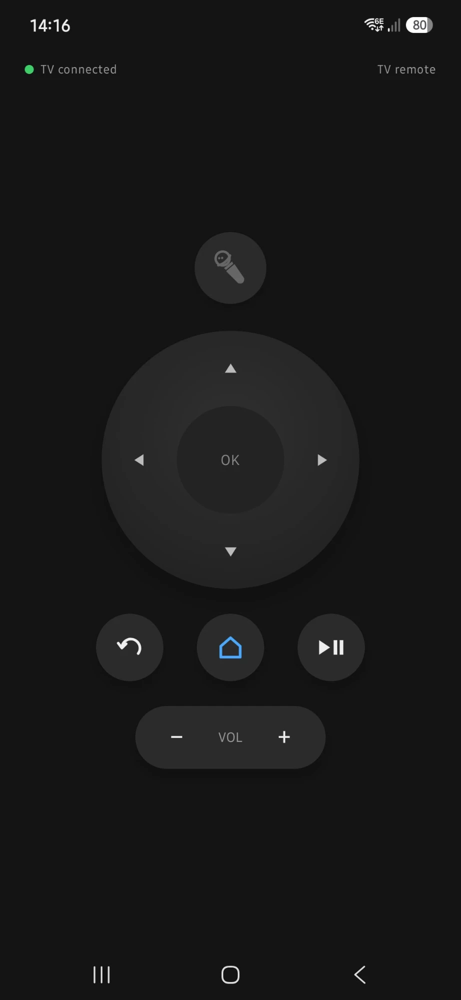

# tv-os

A mini PC as the streaming box for a living-room TV. A full-screen launcher on the mini PC gives the family a TV-style home screen and runs YouTube, Disney+, Channel 4, Netflix, Prime Video and Plex inside it, driven by a remote. The TV itself stays stock: it is only the screen.


The project started because the TV's own apps were slow to open and slow to respond to the remote. Speed is the point: Home returns to the home screen in well under a second.

## What it does

- **A home screen** in the style of [custom-tv](https://github.com/berteotti/custom-tv): the date, a greeting, the weather, rotating Windows Spotlight photos, and one tile per app.
- **The apps inside the launcher's own window.** Each runs in its own WebView2 view, with its own sign-in. YouTube shows its TV interface; Disney+, Channel 4's website, Prime Video and Plex are websites in which the launcher moves focus on the remote's arrows, one item at a time. Netflix, Prime Video and Plex are in the configuration but only lightly tested.
- **Per-app fixes in the configuration,** for example hiding a page element the remote cannot reach (Prime Video's cookie notice).
- **The remote's Home button always returns home.** Leaving an app pauses it through the app's own player, and coming back finds it paused where it was.
- **Back** walks back through Disney+'s pages and then goes home; inside YouTube it stays in YouTube.
- **An Apps screen** (the first button in the top row) to put the home row in the order you like, hide an app, or choose between an app's versions (Channel 4 comes as a TV app and as its website, each with its own sign-in). The choices are kept in `%LOCALAPPDATA%\TvLauncher\state.json`.
- **A Disney+ volume boost** toggled from the home screen, because Disney+ plays much quieter than YouTube.
- **A glass weather card** (Open-Meteo, no API key, no place name), with a moon drawn by its real phase, and a forecast screen with UV, wind, sun, rainfall, visibility and humidity. The place is picked on screen with the remote, or comes from Windows location.
- **A phone remote:** an Android app with the same keys as the physical remote, and a microphone for YouTube's voice search.
- **Windows stays out of sight:** the app tiles wait until Windows HDR is on, the remote's Search and menu keys are swallowed, and restart and shut down ask first.

## How it works

`TvLauncher` is a C# .NET 10 WPF program. Its window holds several WebView2 controls: one shows the home page (an adapted copy of custom-tv, served from `launcher/web` as `https://tvhome.test`), and one more is created for each app the first time it is picked. A low-level keyboard hook catches the remote's Home and Back keys system-wide.

To pause an app, the launcher reads whether its video is playing and, if so, presses Space in the page through the WebView2 DevTools protocol (in-process, no debugging port). It never pauses the video element directly: that was found to wedge Disney+'s player.

## Remotes

### The physical remote

The family's remote is a Rii i25: a 2.4 GHz radio remote with a USB dongle, so it needs no line of sight and Windows sees it as a keyboard. It is used with its air mouse off; with the air mouse on, OK becomes a mouse click and Back a right click.

| Button | What the PC receives | What the launcher does |
|---|---|---|
| D-pad, OK | The arrow keys, Enter | Moves focus and picks, on the home screen and in the apps |
| Home | Browser Home (virtual-key 172) | Pauses the app in front and returns to the home screen, from anywhere |
| Back | Browser Back (166) | Closes an overlay on the home screen; walks back through Disney+'s pages, then goes home; stays inside YouTube |
| Volume, mute, play/pause | The media keys | Left to Windows and the app in front |
| Search, the menu key | Browser Search (170), the menu key (93) | Swallowed while the launcher is in front, so Windows' Start menu never opens |
| Power, Source | Nothing | They are the remote's IR-learnable keys, for the TV and the sound bar |

Windows marks Home, Back and the media keys as injected input; the launcher's low-level hook acts on them anyway. The codes are settings (`HomeKeyVk`, `BackKeyVk`, `SwallowKeyVks`), so another remote can be used by changing `launcher.json`. To find a remote's codes, start the launcher with `--keytest`.

### The phone remote

`remote/android` is an Android app (Kotlin and Jetpack Compose, Android 8.0 or later) that turns a phone into a remote for the launcher. There is no iPhone app.



- **Its keys are the physical remote's, nothing more:** the D-pad and OK, Back, Home, play/pause, and volume down and up. Holding an arrow or a volume key repeats it, after 400 ms and then every 120 ms. The phone gives a short buzz for each press that reached the launcher, and none for one that did not.
- **The microphone** sends the phone's sound to YouTube's own voice search while YouTube is in front (an app with `"PhoneMic": true`). One phone listens at a time, for at most 15 seconds; the launcher logs each session but never the sound. With any other app in front, the button is greyed out.
- **Choosing the PC:** a long press on the status line at the top (it reads, for example, "TV connected") opens "Connect to", with the known launchers by name, or an address and port to type. The known launchers come from `remote/android/launchers.properties`: copy `launchers.example.properties` to that name (git ignores it), put in your own launchers' names and addresses, and build. The first is the one the app uses until another is picked. The build also allows unencrypted traffic to those hosts only (and to `127.0.0.1` for testing over USB), so the app cannot reach a launcher missing from the file.

How it connects: the launcher listens for a WebSocket at `ws://<PC>:47800/remote/v1`, unencrypted, on the home network. The phone sends one small JSON message per press, and the launcher presses the same virtual key the Rii sends, through `SendInput`, so a press from the phone is handled exactly like one from the physical remote. The listener refuses any request that carries an `Origin` header, so a web page in a browser on the network cannot drive it, and an unknown message closes that connection.

To set it up on the PC that runs the launcher:

1. In an elevated Windows PowerShell, add the firewall rule with `setup/phone-remote-firewall.ps1`. It needs `-RemoteAddress`, the phone's network and any other PC that should reach it; `Any` is refused. Run it with `-WhatIf` first; `-Undo` removes the rule.
2. Set `"PhoneRemote": { "Enabled": true }` in `launcher.json` and restart the launcher.

To build and install the app, you need JDK 17 (Android Studio's own runtime works) and the Android SDK, platform 37. Without a `launchers.properties` the build uses the example addresses. In `remote/android`:

```bash
gradlew.bat test assembleDebug
```

```bash
adb install -r app/build/outputs/apk/debug/app-debug.apk
```

To try it over a USB cable instead of Wi-Fi, run `adb reverse tcp:47800 tcp:47800` and pick "Dev PC over USB" in the app. Without a phone, `launcher/tests/manual/remote-client.ps1` plays the phone's part from PowerShell; its presses are real key presses on that PC.

## Hardware

| Part | Model |
|---|---|
| Mini PC | GMKtec NucBox M6 Ultra (Ryzen 5 7640HS, Radeon 760M), Windows 11 Pro |
| TV | Samsung QE55Q60T, 4K HDR at 60 Hz, HDMI from the mini PC |
| Audio | Sound Blaster X-Fi Surround 5.1 Pro over optical to a Bose V30 |
| Remote | Rii i25 (2.4 GHz USB dongle), used with its air mouse off, and an Android phone with the app in `remote/android` |

## Repository layout

| Path | What it holds |
|---|---|
| `launcher/src/TvLauncher` | The WPF host: windows and views, app switching, the keyboard hook, the phone remote's listener (`Remote/`), configuration |
| `remote/android` | The phone remote app, with its unit tests |
| `launcher/web` | The home page (vendored custom-tv, adapted) and its tests in `tools/` |
| `launcher/tests/TvLauncher.Tests` | xUnit tests for the host |
| `launcher/tests/manual` | A manual check harness for the dev PC |
| `setup` | PowerShell scripts for the mini PC: SSH access, Windows settings, deploy, each with a test harness that runs without the mini PC |

## Build and test

You need Windows with the WebView2 runtime (it comes with Windows 11; the mini PC has version 155) and the .NET 10 SDK. Node.js runs the home page's tests.

To build the launcher:

```bash
dotnet build launcher/src/TvLauncher -c Release
```

To run the host's tests:

```bash
dotnet test launcher
```

To run the home page's tests:

```bash
node --test "launcher/web/tools/*.test.cjs"
```

To run the deploy script's tests without the mini PC:

```bash
powershell -NoProfile -ExecutionPolicy Bypass -File setup/test-deploy-launcher.ps1
```

## Run it on a development PC

Start the built `TvLauncher.exe` with:

- `--dev` for development: Alt+F4 closes it, and restart and shut down are only logged;
- `--config <path>` to use a configuration other than the default;
- `--keytest` to show the code of each key pressed. It misses keys Windows handles itself, such as a remote's Browser Home.

Without `--config`, the launcher reads `C:\ProgramData\TvLauncher\launcher.json` if it exists, otherwise the `launcher.json` next to the program. On a monitor without HDR, set `"RequireHdr": false`, or the app tiles never appear.

The launcher logs to `%LOCALAPPDATA%\TvLauncher\launcher.log`.

## Configure

All settings are in `launcher.json`, except the order, visibility and version of the apps, which the Apps screen sets (kept in `state.json`). There is no other settings screen.

| Setting | Meaning |
|---|---|
| `Apps` | One entry per tile: `Id`, `Name`, `Url`, `Icon`, and optionally `UserAgent`, `BrowserArgs`, `BoostGain`, `Back` (`History` or `Page`), `DirectPauseFallback`, `ArrowNav` (the launcher moves focus on the arrow keys, for a site built for a mouse, and slides Swiper carousels at their edge), `HidePlayReady` (the page is told PlayReady is missing, so it uses Widevine), `PauseButton` (the label of the player's pause button, pressed instead of Space), `HideElements` (a CSS selector: what it matches is never shown, for an element the remote cannot reach), `ExitWhenEmpty` (the id of the page's root element: once the app has emptied it, the launcher goes home) and `PhoneMic` (the phone remote's microphone works in this app). An entry can instead carry a `Versions` list of full entries, the first being the default; each version has its own sign-in, and adding a second version to an app that already has one moves its profile and signs it out. Adding a web app is a configuration change. |
| `HomeKeyVk` | The Home key's virtual-key code, or a list of codes (for example `[172, 123]` for a remote's Browser Home and the keyboard's F12) |
| `BackKeyVk` | The Back key's virtual-key code (166, Browser Back) |
| `SwallowKeyVks` | Keys kept from Windows while the launcher is in front (170 Browser Search, 93 the menu key) |
| `RequireHdr` | When true, the app tiles wait until Windows HDR is on |
| `Location` | The weather's place, optional (the repository's `launcher.json` has none). A choice made on screen (a place, Windows location, or no weather) wins over it, and it wins over Windows location |
| `Unit`, `Clock` | The display formats |
| `Locale` | Not used: the launcher is English only (since 2026-11-02) |
| `BackgroundRotateSeconds`, `SpotlightFolders` | The background photo rotation and where Windows keeps its Spotlight photos |
| `MotionTime` | How long the home screen's animations take: 1 (the default) is snappy, 2 twice as long, from 0.5 to 4 |
| `PhoneRemote` | `Enabled` (off by default) and `Port` (47800 by default, from 1024 to 65535) for the phone remote's listener |
| `AllowClose` | When true, Alt+F4 closes the launcher. Off by default, so the TV's home screen cannot be closed by accident |

## Deploy to the mini PC

The mini PC is reached over key-only SSH as `ssh tvbox` (set up with `setup/minipc-enable-ssh.ps1`). From the development PC, this command builds a self-contained release, copies it to the mini PC, swaps it into `C:\Program Files\TvLauncher`, registers the `TvLauncher` scheduled task that starts it at sign-in, and restarts it:

```bash
powershell -NoProfile -ExecutionPolicy Bypass -File setup/deploy-launcher.ps1
```

`-Rollback` swaps back to the previous version. The deploy keeps an existing `C:\ProgramData\TvLauncher\launcher.json`, so a new setting is added there by hand. To stop the launcher on the mini PC, disable the `TvLauncher` task first, or its watchdog starts it again.

`setup/minipc-windows-settings.ps1` sets up the Windows side (automatic sign-in without a password, Windows Update restarts kept out of the evening, notifications off); run it with `-WhatIf` first, and `-Undo` reverses it. Both scripts refuse to run against any PC but the mini PC.

## Status

The launcher is deployed on the mini PC and in family use with YouTube, Disney+ and Channel 4. Netflix, Prime Video and Plex are in the configuration and need more testing with accounts.

## Credits

- The home page is adapted from [custom-tv](https://github.com/berteotti/custom-tv) under its MIT licence; see `launcher/web/LICENSE` and `launcher/web/NOTICE.md`.
- The YouTube user agent follows [VacuumTube](https://github.com/shy1132/VacuumTube)'s, which makes YouTube's TV interface load.
- Weather data from [Open-Meteo](https://open-meteo.com/) (CC BY 4.0).

This repository is under the MIT licence (`LICENSE`); the custom-tv files in `launcher/web` keep their own MIT licence (`launcher/web/LICENSE`). Service names and logos belong to their owners; the licence covers the code only.
